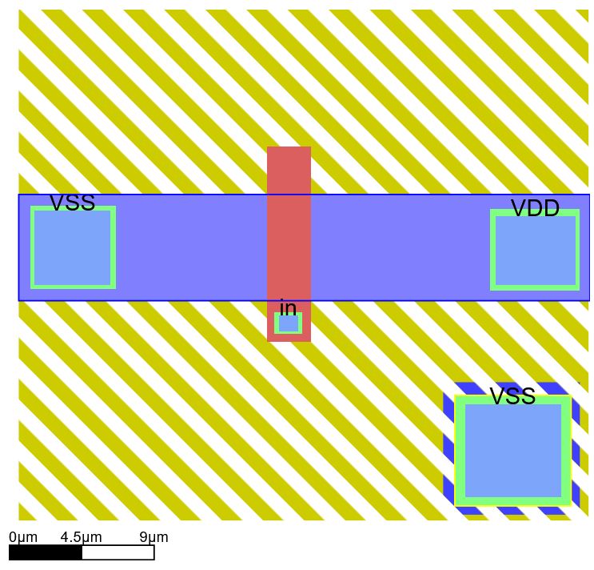
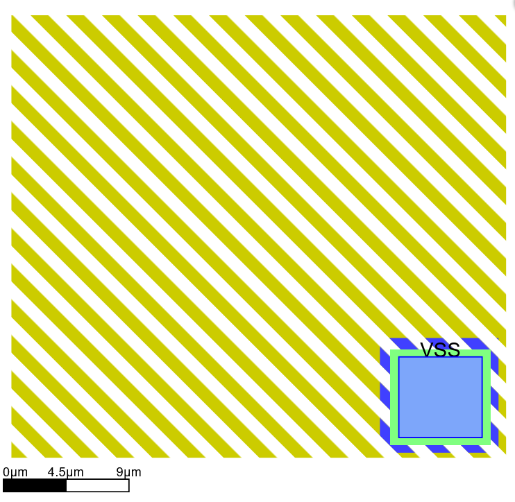
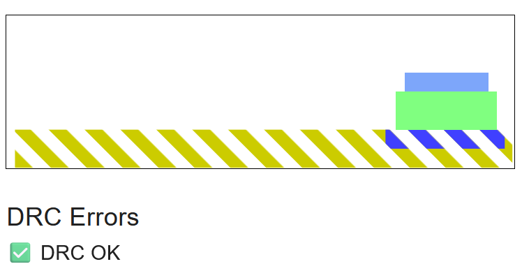
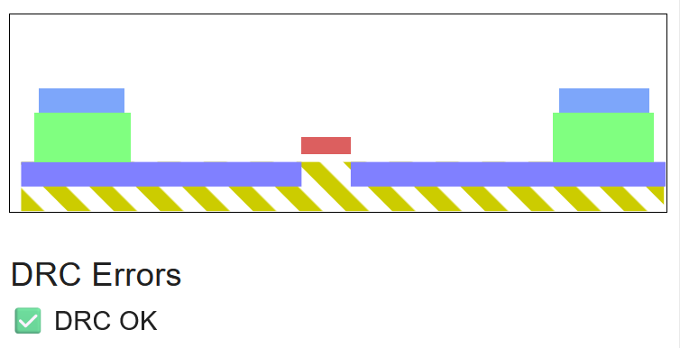
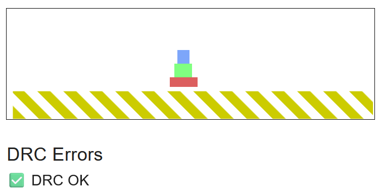
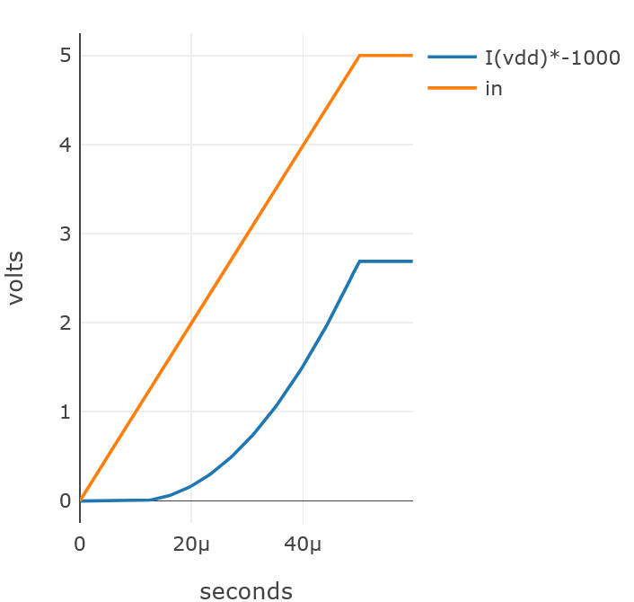
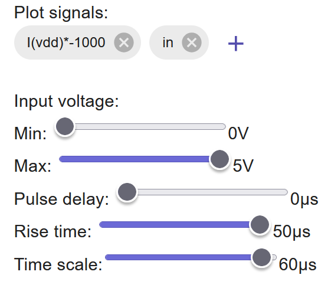

# NMOS Transistor Layout and Simulation

An n-channel MOSFET drawn layer by layer in the SiliWiz layout simulator, checked against its design rules, and simulated by sweeping the gate voltage. The accompanying report connects each layout layer to the physical structure it creates and closes with a look at how such layers are actually fabricated.

> **Course:** EEE 212 Semiconductor Devices and Modeling, Middle East Technical University Northern Cyprus Campus (Spring 2025)<br>
> **Author:** Tunay Arıcı<br>
> **Instructor:** Assoc. Prof. Dr. Tayfun Nesimoğlu<br>
> **Tool:** [SiliWiz](https://app.siliwiz.com/)

<p align="center">
  
</p>

**[Read the full report (PDF)](report/nmos-layout-report.pdf)**

## Contents

- [The layout](#the-layout)
- [Cross sections](#cross-sections)
- [Simulation](#simulation)
- [Effect of gate geometry](#effect-of-gate-geometry)
- [Fabrication](#fabrication)
- [Repository layout](#repository-layout)

## The layout

A transistor on a chip is not a schematic symbol but a stack of overlapping shapes, one per fabrication layer. The device is built from the bottom up:

| Layout element | Physical role |
|---|---|
| p-substrate | Body of the transistor |
| p tap with metal1 contact, labelled `vss` | Holds the body at 0 V through an ohmic contact |
| n-diffusion band | Source and drain regions |
| Polysilicon gate crossing the diffusion | Splits the diffusion into source and drain; controls the channel |
| metal1 contacts `vss`, `vdd`, `in` | Source, drain and gate terminals |

The body connection follows the path

```
vss → metal1 → metal1 via → p tap → p-substrate
```

<table>
  <tr>
    <td align="center"><br>Layout view: the p tap and its <code>vss</code> contact</td>
    <td align="center"><br>Cross section: p-substrate, p tap, via, metal1</td>
  </tr>
</table>

*Before the transistor is drawn, the p tap in the bottom-right corner ties the substrate to 0 V through an ohmic contact.*

The design rule checker reports **DRC OK**, so the layout has no spacing or overlap violations.

## Cross sections

Slicing the layout at two positions shows the vertical structure that the top-down drawing hides.

<table>
  <tr>
    <td align="center"><br>Through the transistor: source, polysilicon gate, drain</td>
    <td align="center"><br>Through the gate contact: polysilicon, via, metal1</td>
  </tr>
</table>

## Simulation

The gate voltage is swept from 0 V to 5 V over 50 µs while the drain current is recorded.

<p align="center">
  
</p>

| Region | Behaviour |
|---|---|
| Off | Below the threshold voltage no channel exists and the drain current is zero |
| Turn-on | Once V<sub>GS</sub> exceeds V<sub>th</sub>, the gate field pulls electrons to the surface and an n-type channel links source and drain |
| Saturation | The channel pinches off at the drain end; the current levels off at about **2.7 mA** at V<sub>GS</sub> = 5 V |

<details>
<summary><b>Simulation settings</b></summary>



Input swept from 0 V to 5 V with no delay, 50 µs rise time and a 60 µs time window.

</details>

The simulator reports current into `vdd` as negative, so it is plotted as `I(vdd) × −1000` to read positive milliamps.

## Effect of gate geometry

In saturation the drain current follows the square law

```
I_D = ½ · µn · C_ox · (W/L) · (V_GS − V_th)²
```

- **Longer gate (larger L)** lowers W/L, reducing drain current and transconductance, and increases gate capacitance `C_G = C_ox · W · L`, which slows switching.
- **Wider gate (larger W)** raises W/L and the current. This is why the diffusion in this layout spans the full width.

## Fabrication

The report ends with a short study of how these layers are made, based on the IHP cleanroom tour:

- **Photolithography.** i-line (365 nm) and DUV (248 nm) steppers project mask patterns onto photoresist. Resolution follows the Rayleigh criterion `CD = k1 · λ / NA`, which is why the industry moved to EUV at 13.5 nm and to High-NA EUV (NA 0.55) for single-exposure patterning of the finest features.
- **Masking.** Each mask confines etching, doping or deposition to selected areas; a single particle on the mask becomes a defect on every exposed wafer.
- **Ion implantation.** Mass-selected, energy-controlled dopant beams give independent control of depth and concentration, followed by rapid thermal annealing to repair the crystal and activate the dopants.

## Repository layout

```
nmos-layout/
├── README.md
├── report/
│   └── nmos-layout-report.pdf
└── media/       figures used in this page
```
